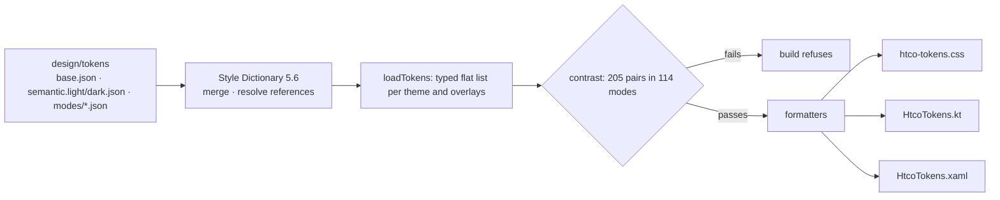

# Design tokens — Design

## Flow

| Module | Responsibility |
|---|---|
| `src/tokens.ts` | Load one theme plus overlays with Style Dictionary (no transforms), validate every value's shape into a typed `Token`, and remember semantic aliases |
| `src/modes.ts` | The Design 1C modes (palette, theme, tweak levels), the overlay files of each, and the CSS cascade layers with the attributes they apply on |
| `src/publish.ts` | Which tokens are published (not the palette, raw brand colours or breakpoints), which change with the theme, names and colour conversions |
| `src/css.ts`, `src/kotlin.ts`, `src/xaml.ts` | One formatter per platform |
| `src/contrast.ts` | WCAG ratio, alpha compositing and the 205 pairs: text on nine surfaces at 4.5:1, controls, focus rings, dots and icons at 3:1, and the named pairs; translucent backgrounds are measured over the mode's backdrops |
| `src/build.ts` | `renderAll()` for the drift test, `modeFailures()` per mode; `node src/build.ts` (via `pnpm tokens`) checks contrast in every mode, then writes `generated/` |

## Decisions and alternatives

| Decision | Alternatives considered | Why |
|---|---|---|
| Style Dictionary for parsing and references; our own formatters | Built-in `css/variables` and `compose/object` formats | One CSS file must hold both themes; the Compose transforms assume rem; small formatters are easy to test. |
| Contrast check in TypeScript with tests, run by the build and CI | The earlier `design/tokens/check-contrast.mjs` | One implementation, tested, sharing the loader; the build cannot produce outputs that fail contrast. |
| Generated files committed | Build in CI or at app build time | Reviewers see token changes as diffs on every platform; Android and Windows builds need no Node. |
| Kotlin package `app.htco.designsystem.tokens` | Decide with the Android app | Follows the product domain `ht-co.app`; a rename later is one line in `src/kotlin.ts`. |
| Palettes and tweaks as DTCG overlays in cascade layers (client ADR-0008) | One CSS file per palette; JavaScript setting variables | One stylesheet, no flash (attributes are set before first paint), and every mode stays in the contrast check. |
| Semantic aliases emitted as `var()` | Resolved values in every block | An overlay changes `bg.panel` once and every alias (`bg.canvas`, `bg.table-head`) follows it. |
