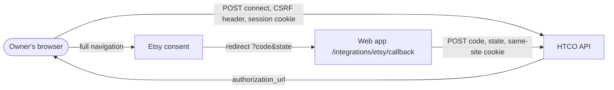

# Shops — Security

## Data flow and trust boundaries

## Threats (STRIDE)

| Element | Threat | Control | Test |
|---|---|---|---|
| Authorization address | Tampering: the app sent to a hostile scheme (`javascript:`) | Only https or same-origin addresses are followed | `never sends the browser to an address that is not https` |
| Callback query | Information disclosure: the code stays in the address bar and history | Replaced at once without the query; the confirmation uses history state | `removes the code from the address bar straight away` |
| Callback | Replay or double submission | Sent once per page (ref guard, StrictMode-safe); the API rejects a reused state | `finishes the connection once and shows the shop` |
| Connect | Elevation of privilege | Offered to the Owner only; the API enforces Owner, aal2 and a recent step-up | `does not offer a admin/support to connect a shop` |
| Shop card | Information disclosure | The API never returns tokens; roles below Admin get no connection details | `shows other roles their shops without connection details` |

## Personal data

None new on the client: shop names, Etsy shop IDs and connection metadata only. No tokens in JavaScript (golden rule 6).
